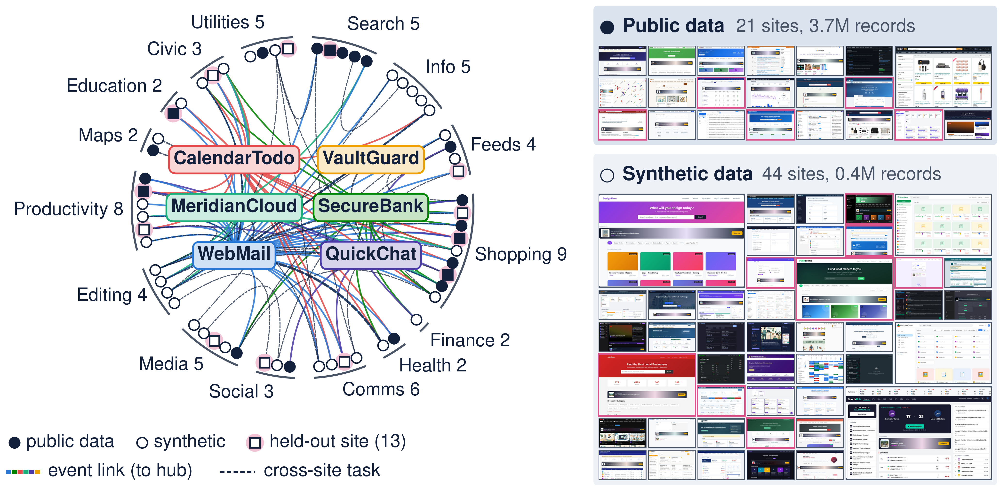
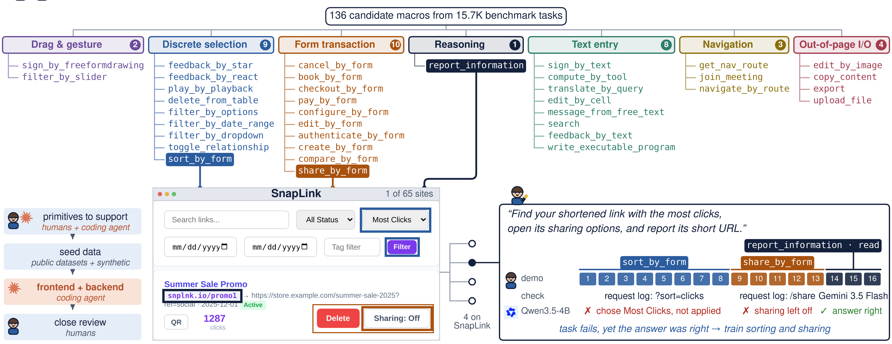
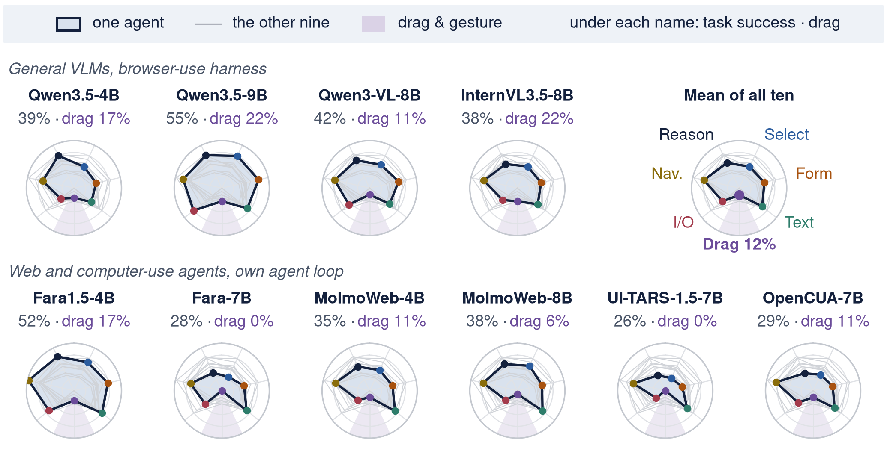
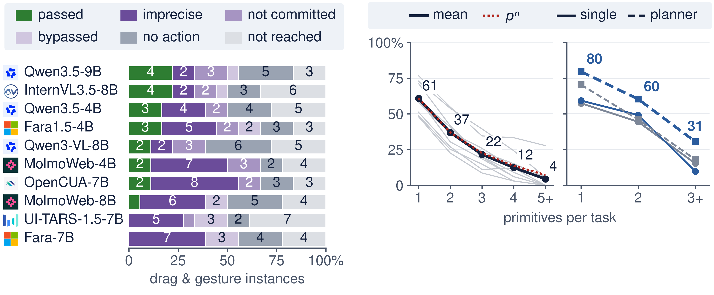
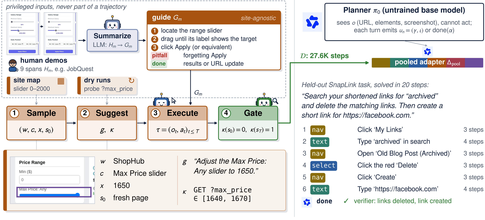
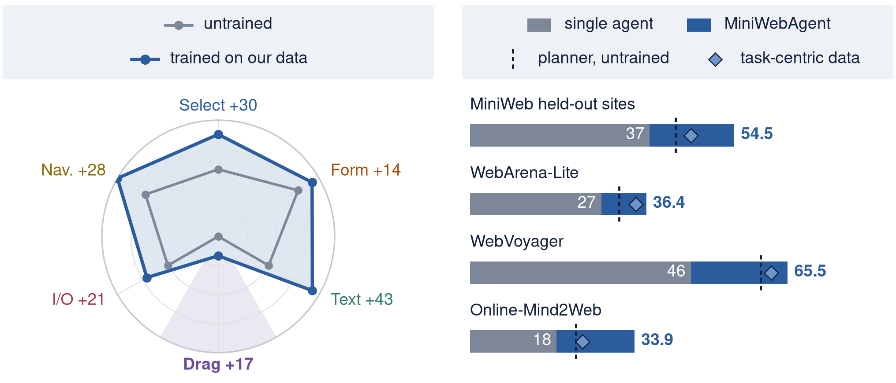

# MiniWeb

**Diagnose and train web agents one skill at a time.** MiniWeb is 65 synthetic websites served by one Flask app,
369 human-written tasks whose verifiers grade every interaction skill separately, and a pipeline that turns a few
human demonstrations into thousands of verified practice trajectories.



Most benchmarks give an agent one score per task. A task that asks to search a map, set a rating slider and open a
result fails as a whole when only the slider goes wrong. MiniWeb breaks every task into **primitives**, reusable
interaction skills such as `filter_by_slider`, `create_by_form` or `report_information`, and its verifiers check each
one against the server's request log. A run then says which skills an agent has.

## Built from the primitives up



- **37 primitives in 7 skill families**, kept from 46 candidates after labeling 15.7K tasks of WebArena, WebShop,
  WebVoyager and Mind2Web and adding the interactions those benchmarks miss (dragging, drawing, uploading, editing
  cells). The registry is `data/macros.yaml`; the final set is `data/final_set.yaml`.
- **65 websites in 15 domains** that share one fictional world, so a task can pay a bill in SecureBank and confirm it by
  email in WebMail. 21 sites are seeded from public datasets, the other 44 from deterministic synthetic data.
- **369 tasks** written and recorded by six annotators, 43 of them across sites. Each comes with a skill-segmented
  demonstration and a verifier with one check per primitive, validated against the demonstrations and two negative
  controls.
- **13 held-out sites**, fixed before any training data was generated. The 62 tasks that start on them are the test set.

## Every agent has the same blind spot



Ten open-weight agents, four general models in the browser-use harness and six web or computer-use agents in their own
loops, all show the same dent. Pooled over agents, drag & gesture instances pass 11.7% of the time against 35.7% for
the next-weakest family. Web-trained agents drag worse than general models (7.5% vs. 18.0%) while typing better, which
suggests end-to-end web training underrepresents rare interactions.



The failures are local (left). In 72% of failed drag instances the agent reaches the right slider or canvas and fails
during the gesture or right after it: a drag is planned from one screenshot, and the value it sets is only visible after
release. Task success compounds over a task's primitives (right), so a weak skill costs more the longer the task.

## Practice the skills, then compose them



**MiniWebGen** (`src/miniwebgen/`) scales the human demonstrations into practice. A crawler maps the controls that
realize each primitive on each training site; an LLM distills the human spans of a primitive into a guide, phrases a
task, and writes a short script that acts only through mouse and keyboard events; an attempt is kept only if the
backend shows the change the task asked for. The result is 3,128 verified trajectories at about $0.04 each, replayed
into 27.6K training steps with variants that inject and correct a mistake or chain two trajectories.

**MiniWebAgent** (`src/miniwebagent/`) adds a planner. The untrained Qwen3.5-4B plans; each primitive-level step goes
to one LoRA executor trained on MiniWebGen's data, on the same browser, and reasoning steps stay with the base model.



Training Qwen3.5-4B on this data lifts every skill family on unseen sites by 14 to 43 points (left). On its own, though,
the trained agent learns to stop after one primitive, which is why it runs under the planner. Without training on any of
these benchmarks, MiniWebAgent improves on the base model on all four (right). An executor trained on the same number
of steps of task-centric trajectories, collected on the same training sites with InSTA's pipeline
(`src/miniwebgen/taskgen.py`), does not significantly improve the untrained planner on any of them. The held-out sites
and WebArena-Lite average three runs; the live-web benchmarks leave out impossible tasks and sites that block our
network.

## Get started

### 1. Install

```bash
git clone https://github.com/miniweb-site/MiniWeb.git && cd MiniWeb
conda env create -f environment.yml       # requirements.txt + the src/ packages: miniweb, miniwebgen, miniwebagent, helpers
conda activate miniweb
python -m playwright install chromium     # the agents' browser
```

Tested on Ubuntu 22.04 (x86_64); the sites need no GPU. Without conda: `pip install -r requirements.txt && pip install -e .`
under Python 3.11. Training and serving models use a second environment with vLLM, and the paper's exact environments
are in `scripts/envs/` ([REPRODUCE.md](REPRODUCE.md#what-you-need)).

### 2. Download the data

All data is on the Hugging Face Hub: **[huggingface.co/datasets/sparklabuofu/MiniWeb](https://huggingface.co/datasets/sparklabuofu/MiniWeb)**.
Two scripts put what the code needs in place:

```bash
python scripts/restore_site_db.py   # the sites: database, images and a copy of the media they link to (~8 GB)
                                    #   -> data/miniweb.db, data/static/, data/media/
python scripts/fetch_tasks.py       # the 369 human tasks: task, verifier, recording, verification walk
                                    #   -> data/annotations/<author>/<task_id>/
```

The site database is the one the tasks were made on, search indexes included, so do not rebuild it with
`build_db.py`. The media copy lets the sites render without the internet: the server serves it at `/media/...` and
rewrites the pages' links to it (`src/miniweb/app/media.py`).

Every table of the release also loads directly with `datasets`, screenshots as images:

```python
from datasets import load_dataset
tasks = load_dataset("sparklabuofu/MiniWeb", "tasks", split="test")                         # the 62 held-out tasks
steps = load_dataset("sparklabuofu/MiniWeb", "training_steps", split="train", streaming=True)  # MiniWebAgent's training data
```

| Table | Rows | One row per |
|---|---|---|
| `tasks` | 369 (train 304, test 62, excluded 3) | human task: instruction, primitives, verifier, the annotator's original version, provenance |
| `demonstrations` | 17.4K | recorded event of a human demonstration, with the page's HTML, accessibility tree and screenshot |
| `miniwebgen_trajectories`, `miniwebgen_steps` | 3,128 / 17.1K | MiniWebGen's verified single-primitive trajectories and their steps |
| `training_steps` | 31K | MiniWebAgent's training data, in the agent harness's format, with the step's screenshot |
| `task_centric_tasks`, `task_centric_steps` | 7,280 / 27.6K | the task-centric comparison data |
| `single_primitive_test_tasks` | 115 | generated single-primitive tasks of the held-out sites |
| `sites`, `primitives`, `guides` | 65 / 53 / 46 | the websites with their data sources and licenses, the macro registry, MiniWebGen's guides |

`test` is the 13 held-out sites: no training data comes from them. Annotators appear as pseudonyms (A1 to A6).

### 3. Configure

The sites need no configuration: the server reads `data/miniweb.db` and stops with a message if it is missing or
empty. For the LLM keys, the annotation tool and other locations, create `.env` from `.env.example`:

```bash
MINIWEB_DB="data/miniweb.db"
MINIWEB_ANNOTATIONS_DIR="data/annotations"
MINIWEB_ANNOTATORS="alice:secret,bob:secret"     # annotation-tool logins
GEMINI_API_KEY=...                               # or GOOGLE_GENAI_USE_VERTEXAI + GOOGLE_CREDENTIALS_JSON
OPENAI_API_KEY=...                               # only the providers you use (routing: src/helpers/llm.py)
```

The parser takes `KEY=VALUE` lines and whole-line comments. The sites run without an LLM key; the VLM judge,
MiniWebGen, and the verifier checks that compare free text by meaning need one.

### 4. Run the sites

```bash
python run.py                              # http://localhost:8080
MINIWEB_SITES=banking,email python run.py  # only some sites, for a faster start
```

- `/` lists every site, and `/sites/<site>/` opens one (visitors are logged in as user 1; login tasks turn this off).
- `/annotate/login` opens the annotation tool: its dashboard, the task recorder, the Verifier Builder, Task Review and
  the Macro Browser ([src/miniweb/annotation/README.md](src/miniweb/annotation/README.md)).
- `/_admin/...` serves the grading endpoints: the request log, the recorder stream and the data changes of a session
  ([src/miniweb/app/README.md](src/miniweb/app/README.md)).

Production runs `gunicorn run:app` (`Procfile`, `Dockerfile`).

### 5. Evaluate an agent

```bash
# one task (starts its own server; --model mock checks the pipeline without a model)
python src/miniweb/evaluation/run_agent_verify.py --task-id crm_bf9346 --model mock

# the held-out tasks with the browser-use harness and a served model
python -m miniwebagent.evaluate --human --arm base --base-name qwen35-4b --vllm http://127.0.0.1:8400/v1 --out runs/base
```

MiniWebAgent's trained executor is on the Hub as well
([huggingface.co/sparklabuofu/MiniWebAgent](https://huggingface.co/sparklabuofu/MiniWebAgent)); `python scripts/fetch_adapters.py`
puts it in `data/webmix/adapters/`. **[GUIDE.md](GUIDE.md)** covers the common jobs: hosting MiniWeb, running the 369
tasks with your agent, per-primitive failure reports, choosing a grader, generating more data for a primitive or a
skill family, and training an executor.

### Reproduce the paper

```bash
python scripts/reproduce.py show planner_pooled     # MiniWebAgent: model server, run and grading commands per benchmark
python scripts/reproduce.py run planner_pooled --bench heldout --seed 1 --execute
python scripts/reproduce.py table                   # your runs next to the paper's numbers
python -m pytest                                    # tests
```

**[REPRODUCE.md](REPRODUCE.md)** walks through every table: what each needs (environments, keys, compute, cost), the
commands, and how close to expect. `scripts/paper.yaml` is the registry of every run, adapter and benchmark setting.

### Generate the data

```bash
python scripts/generate_data.py                            # every step and its exact commands (nothing runs)
python scripts/generate_data.py --run --steps generate     # MiniWebGen's generation runs, with their recorded arguments
python scripts/generate_data.py --run --steps replay,augment,valset,taskgen,release
```

The steps follow the paper: the site split, MiniWebGen's site maps and per-primitive guides, the generation runs,
the replay into training episodes with the recovery and chain variants, the training pool, the generated test tasks of
the held-out sites, the task-centric comparison data, and the release.

### Build the release

The Hub release is built from the working data in two steps. `python scripts/build_release.py` consolidates
everything the paper uses into `data/release/miniweb-v1/`, split by the held-out sites and free of personal information
(annotators appear as pseudonyms; the build audits every file it writes; every task keeps its original and its reviewed
version, and `provenance.json` says what the review changed). `python scripts/build_hf_dataset.py` converts it to the
Hub's Parquet tables, `scripts/fetch_site_media.py` downloads the media the sites link to, and
`scripts/export_site_db.py` exports the site database, its images and that media to `site_db/`.

## Repository map

```
src/miniweb/        the benchmark: app/ (Flask app, per-site SQLite with session overlays, /_admin grading
                    endpoints), sites/ (65 sites), annotation/ (the /annotate tool), evaluation/ (verifiers, the
                    VLM judge, agent runners), scripts/ (database seeds, task-set tools)
src/miniwebgen/     the data pipeline (python -m miniwebgen), replay into training rows (python -m miniwebgen replay),
                    taskgen.py (task-centric data), scripts/ (test tasks, training-pool builders)
src/miniwebagent/   the harness, the planner agent, LoRA training, the evaluators for MiniWeb, WebArena-Lite and
                    the live web, scripts/ (vLLM serving, cluster wrappers)
src/helpers/        shared utilities: LLM routing, the repository root
scripts/            the paper's entry points: reproduce.py, generate_data.py, paper.yaml, pools/, benchmarks/
                    (the live-web task sets), skill_report.py (per-skill results of a run); the data release:
                    restore_site_db.py, fetch_tasks.py, fetch_training_data.py, fetch_adapters.py,
                    build_release.py, build_hf_dataset.py, export_site_db.py, fetch_site_media.py
data/               macros.yaml, macro_locations.yaml, final_set.yaml, sites.yaml (tracked); the database,
                    annotations, generated data and runs (not tracked)
assets/readme/      the figures above
tests/              pytest suite
```

Each package has its own README; the rules for site code (database access, session isolation) are in
[src/miniweb/app/README.md](src/miniweb/app/README.md).
